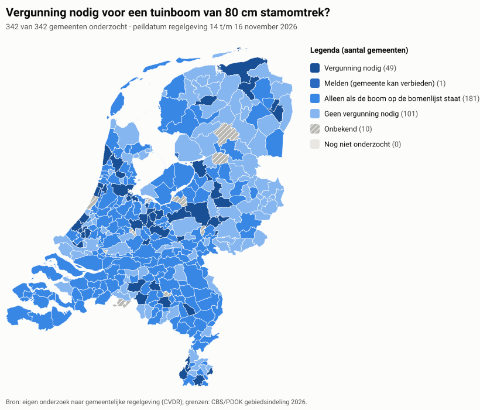

# Kapregels voor bomen in alle Nederlandse gemeenten

Mag je een boom in je eigen tuin kappen? Dat hangt af van je gemeente. Elke gemeente maakt eigen regels, en een landelijk overzicht bestaat niet. Dit project maakt dat overzicht: voor alle 342 gemeenten (indeling 2026), op basis van de regels zoals ze officieel zijn gepubliceerd.

> **Stand:** alle 342 gemeenten zijn onderzocht (peildatum 14 t/m 16 november 2026). Lees het [rapport](output/rapport.md) voor de uitleg en de belangrijkste uitkomsten.

## In het kort

- In **332 gemeenten** heb je voor ten minste een deel van de bomen in je tuin een vergunning nodig. In **10 gemeenten** niet.
- **149 gemeenten** beschermen bomen in de hele kom vanaf een bepaalde stamdikte. **146 gemeenten** alleen bomen op een lijst of kaart.
- De stamdikte waarboven je een vergunning nodig hebt, loopt uiteen van **30 cm tot 361 cm** stamomtrek.
- Voor een tuinboom van 80 cm stamomtrek heb je in **49 gemeenten** een vergunning nodig, in **101 gemeenten** niet, en in **181 gemeenten** alleen als de boom op een lijst staat.

## Kaarten



**Interactieve kaartpagina:** [docs/index.html](docs/index.html), met wisselen tussen boom A, boom B en strengheid, zoeken op gemeente, informatie bij aanwijzen en een tabel van alle gemeenten. Publiceren via GitHub Pages: *Settings → Pages → Deploy from a branch → `main`, map `/docs`*. Lokaal bekijken: `cd docs && python3 -m http.server` en open http://localhost:8000.

**Interactieve kaarten op GitHub zelf** (inzoomen en klikken op een gemeente voor de gegevens en de bron):

| Kaart | Interactief | Afbeelding |
|---|---|---|
| Vergunning nodig voor een tuinboom van 80 cm? | [kaart_boom_a.geojson](output/kaart_boom_a.geojson) | [svg](output/kaart_boom_a.svg) |
| Vergunning nodig voor een tuinboom van 40 cm? | [kaart_boom_b.geojson](output/kaart_boom_b.geojson) | [svg](output/kaart_boom_b.svg) |
| Strengheid van de kapregels | [kaart_strengheid.geojson](output/kaart_strengheid.geojson) | [svg](output/kaart_strengheid.svg) |

## Twee voorbeeldbomen

Om gemeenten eerlijk te vergelijken, kijken we steeds naar dezelfde twee bomen. Beide staan gezond in een achtertuin binnen de bebouwde kom, en zijn geen fruitboom, conifeer, populier of wilg.

| | Stamomtrek op 1,30 m hoogte | Ongeveer zo dik |
|---|---|---|
| **Boom A** | 80 cm | 25 cm doorsnee, een flinke tuinboom |
| **Boom B** | 40 cm | 13 cm doorsnee, een jonge boom |

Per gemeente staat of je voor die boom een vergunning nodig hebt: **ja**, **nee**, of **alleen als de boom op de bomenlijst van de gemeente staat**.

## Resultaten

| Bestand | Wat staat erin |
|---|---|
| [output/rapport.md](output/rapport.md) | Het rapport: werkwijze, uitkomsten, voorbeelden van buurgemeenten, herplant, beperkingen |
| [output/alle_gemeenten.csv](output/alle_gemeenten.csv) | Eén regel per gemeente: bron, drempel, voorbeeldbomen, herplant, sancties, score |
| [output/samenvatting.md](output/samenvatting.md) | Alle tellingen, ook per provincie |
| [output/alle_afwijkingen.md](output/alle_afwijkingen.md) | Gemeenten waar iets onzeker is, en waarom |
| [output/ontbrekende_lijsten.md](output/ontbrekende_lijsten.md) | Gemeenten waarvan de bomenlijst of -kaart niet te vinden was |
| [output/rijen/](output/rijen/) | Alle bevindingen per gemeente, met letterlijke citaten uit de regels |
| `output/<provincie>.csv` | Dezelfde tabel per provincie |

De CSV gebruikt puntkomma's en UTF-8, zodat hij direct in Excel opent.

## Hoe is dit onderzocht?

- **Bronnen.** Alleen officiële bronnen: de gemeentelijke regels op [lokaleregelgeving.overheid.nl](https://lokaleregelgeving.overheid.nl), bekendmakingen op [officielebekendmakingen.nl](https://zoek.officielebekendmakingen.nl), de gemeentelijst van het [CBS](https://opendata.cbs.nl) en de gemeentegrenzen van [PDOK](https://www.pdok.nl). Voor oude bestemmingsplannen en het omgevingsplan: het [DSO](https://omgevingswet.overheid.nl) en Ruimtelijke plannen. Peildatum: 14 t/m 16 november 2026.
- **Controleerbaar.** Elke bevinding verwijst naar een regeling (CVDR-nummer met versie) en een artikel. De doorslaggevende zinnen staan er letterlijk bij.
- **Scoringsmodel.** Naast de feiten krijgt elke gemeente een strengheidsscore van 0 tot 100. Die laat zien voor hoeveel tuinbomen de regels gelden, hoe kritisch de gemeente een aanvraag beoordeelt, of je moet herplanten en wat er gebeurt als je zonder vergunning kapt. Zie [SCORINGSMODEL.md](SCORINGSMODEL.md) voor de uitleg.
- **Onzekerheid.** Kan iets niet worden vastgesteld, dan staat dat erbij, met een bereik in plaats van één getal. Een veelvoorkomende reden: de bomenlijst van de gemeente staat niet online.
- **Werkwijze.** De volledige onderzoeksopdracht staat in [INTENT.md](INTENT.md).

## Bekende beperkingen

- **Omgevingsplan.** Sinds 2024 kunnen kapregels ook in het omgevingsplan van een gemeente staan. Alle 342 omgevingsplannen zijn via het DSO doorzocht. Bij een paar gemeenten is de regel nog onzeker (zie de afwijkingenlijsten).
- **Bomenlijsten.** Werkt een gemeente met een lijst van beschermde bomen, dan hangt veel af van welke bomen erop staan. Niet elke lijst is online te vinden.
- **Momentopname.** Gemeenten passen hun regels geregeld aan. Het overzicht geldt voor de peildatum.

## Klopt er iets niet?

Werk je bij een gemeente, of zie je een fout? [Open een issue](../../issues) met de naam van de gemeente en de regel (CVDR-nummer en artikel) die volgens jou geldt. We controleren het aan de hand van de officiële tekst.

## Zelf draaien

Je hebt alleen Python 3.10 of nieuwer nodig. Er worden geen extra pakketten geïnstalleerd.

```bash
git clone <deze repo>
cd <map van de repo>
python3 -m venv .venv
source .venv/bin/activate          # Windows: .venv\Scripts\activate
pip install -e .

bomen gemeenten                    # gemeentelijst 2026 van het CBS
bomen ophalen --provincie Zeeland  # regels en bekendmakingen ophalen (enkele minuten)
bomen ophalen --alles              # alle 342 gemeenten (ongeveer 20 minuten, 2 GB)
bomen csv --provincie Zeeland      # CSV en afwijkingenlijst uit output/rijen/
bomen csv                          # alle gemeenten samen
bomen kaart                        # kaarten opnieuw maken
bomen samenvatting                 # tellingen voor het rapport
bomen dso --alles                  # omgevingsplannen uit het DSO (API-sleutel nodig in .env, 1 verzoek per 3 s)
```

Met [uv](https://docs.astral.sh/uv/) kan het ook zonder venv: `uv run bomen ophalen --provincie Zeeland`.

De opgehaalde bronteksten (ongeveer 2 GB) staan niet in deze repository. `bomen ophalen` haalt ze opnieuw op bij de officiële bronnen. Elk opgehaald bestand komt in `data/manifest.jsonl`, met URL, tijdstip en sha256-controlegetal.

### Mappen

```
bomen/                 Python-code (ophalen, tekst omzetten, scores, kaarten)
config/aliassen.json   zoeknamen voor zes gemeenten waar de CBS-naam niet werkt
data/
  gemeenten_2026.csv   gemeentelijst (CBS 86247NED)
  gemeenten/<provincie>/<GM-code>_<naam>/
    index.md           overzicht van de geldende regelingen voor deze gemeente
    bronnen.json       zoekvragen, aantallen, peildatum
    regelingen.jsonl   gegevens van alle gevonden regelingen, ook vervallen versies
  manifest.jsonl       herkomst van elk opgehaald bestand
output/
  rijen/<GM-code>.json bevindingen per gemeente
  <provincie>.csv      tabel per provincie
  kaart_*.svg          kaarten
  kaart_*.geojson      interactieve kaarten (GitHub toont ze als kaart)
docs/
  index.html           interactieve kaartpagina (GitHub Pages)
  gemeenten.geojson    data voor die pagina (gemaakt door `bomen kaart`)
  rapport.md           het rapport
  samenvatting.md      tellingen voor het rapport
```

### Hoe de scores ontstaan

1. `bomen ophalen` verzamelt per gemeente de regelingen en zet de tekst om naar leesbare markdown.
2. Een onderzoeker leest de regels volgens [INTENT.md](INTENT.md) en legt de bevindingen vast in `output/rijen/<GM-code>.json`. In dit project gebeurde dat met hulp van AI-agents die werken volgens [output/BRIEF_AGENT.md](output/BRIEF_AGENT.md). De doorslaggevende citaten zijn steekproefsgewijs met de hand gecontroleerd.
3. `bomen csv` rekent de scores uit en maakt de tabellen. `bomen kaart` maakt de kaarten.

## Licentie

- **Data, kaarten en rapport:** [CC BY 4.0](LICENSE-DATA.md). Gebruik is vrij, met bronvermelding.
- **Code:** [MIT](LICENSE).
- **Teksten van gemeentelijke regelingen:** daar rust geen auteursrecht op (art. 11 Auteurswet).

## Privacy

Bomenlijsten en bekendmakingen bevatten soms namen en adressen van boomeigenaren. Die staan niet in deze repository. Bevindingen verwijzen naar een besluit via het officiële kenmerk, niet via een adres.
