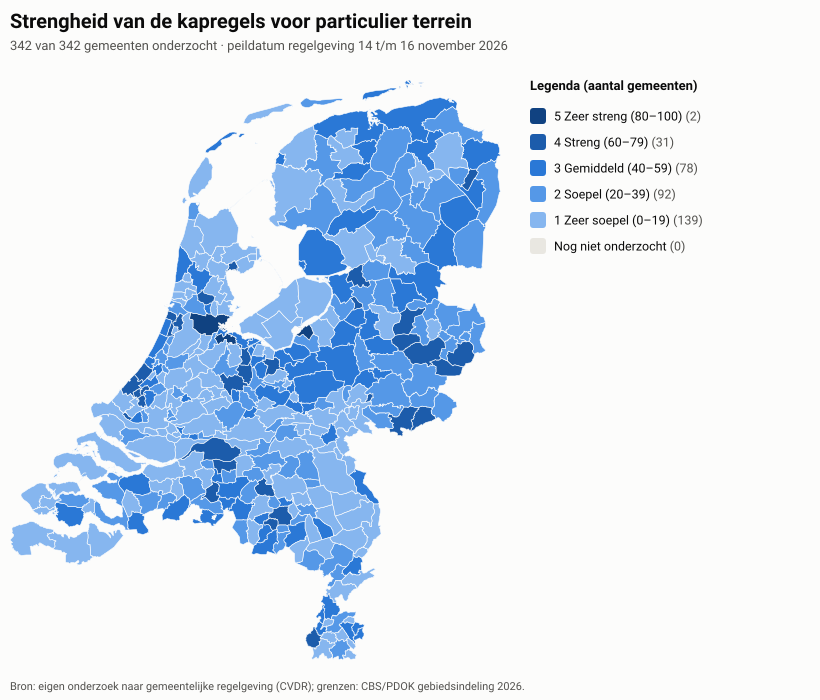
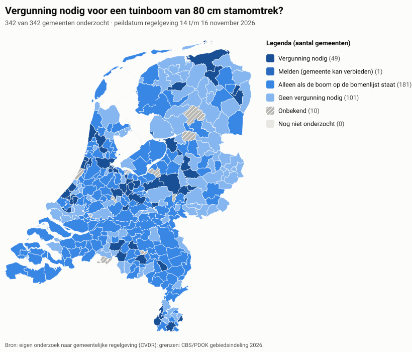

# Kapregels voor bomen in particuliere tuinen: alle 342 gemeenten vergeleken

**Peildatum:** 14 tot en met 16 november 2026 (de stand op de dag van onderzoek).
**Gegevens:** alle cijfers in dit rapport komen uit `output/alle_gemeenten.csv` en `output/samenvatting.md`. Per gemeente staan de bronnen, artikelen en letterlijke citaten in `output/rijen/<CBS-code>.json`.

---

## In het kort

- Wie in Nederland een boom in de eigen tuin wil kappen, krijgt per gemeente met andere regels te maken. Er is geen landelijke regel voor particuliere bomen.
- We hebben de regels van alle 342 gemeenten gelezen en vergeleken. In **332 gemeenten** geldt een vergunningplicht voor ten minste een deel van de particuliere bomen. In **10 gemeenten** is er geen vergunningplicht voor particuliere bomen.
- Ongeveer de helft van de gemeenten (**149**) beschermt bomen in de hele bebouwde kom of de hele gemeente, vanaf een bepaalde stamdikte. Bijna even veel gemeenten (**146**) beschermen alleen bomen die op een lijst of kaart staan.
- De stamdikte waarboven je een vergunning nodig hebt, loopt uiteen van **30 cm** tot **361 cm** stamomtrek. De helft van die gemeenten zit op of onder 80 cm.
- Voor dezelfde gezonde tuinboom van 80 cm stamomtrek heb je in **49 gemeenten** een vergunning nodig. In **101 gemeenten** niet. In **181 gemeenten** alleen als de boom op een lijst of kaart staat.
- In **254 gemeenten** mag de gemeente herplant opleggen ("kan"), maar hoeft dat niet. Een vaste plicht om opnieuw te planten staat in **39 gemeenten**.

---

## 1. Aanleiding en onderzoeksvraag

### Waarom dit onderzoek

Sinds 1 januari 2024 geldt de Omgevingswet. Elke gemeente bepaalt zelf of en hoe zij het kappen van bomen regelt. Er bestond nog geen overzicht van hoe alle gemeenten dat doen. Zo'n overzicht is voor één persoon bijna niet te maken: het gaat om honderden verordeningen, beleidsregels en kaarten.

Dit rapport maakt de verschillen zichtbaar en controleerbaar. Het beschrijft de regels feitelijk. Het doet geen aanbevelingen over hoe de regels zouden moeten zijn.

### De onderzoeksvraag

> Welke regels gelden in elke Nederlandse gemeente voor het kappen van een boom op particulier terrein, en hoe verschillen die regels van elkaar?

Met **particulier terrein** bedoelen we het perceel van een burger: een gewone tuin bij een woning. Bomen van de gemeente, van bedrijven of van terreinbeheerders vallen buiten dit onderzoek.

---

## 2. Bronnen en werkwijze

### Welke bronnen

We werken alleen met **primaire bronnen**: de officiële teksten zelf, niet met samenvattingen of nieuwsberichten.

- **CVDR** (lokaleregelgeving.overheid.nl): alle gemeentelijke verordeningen en beleidsregels. Denk aan de APV, een bomenverordening of de legesverordening.
- **DSO** (Digitaal Stelsel Omgevingswet): het omgevingsplan van elke gemeente.
- **Ruimtelijke plannen**: oude bestemmingsplannen die nog deel uitmaken van het omgevingsplan.
- **Officiële bekendmakingen**: verleende en geweigerde kapvergunningen, als controle op de praktijk.
- **Gemeentelijke websites**: alleen om bomenlijsten en -kaarten te zoeken.

Bij elke bewering staat in de dataset waar die vandaan komt: het CVDR-nummer, het artikel en de peildatum. Een gemeente die het niet eens is met een bevinding, kan zo precies zien waarop die berust.

### Hoe we te werk gingen

1. Per gemeente hebben we alle geldende regelingen over bomen opgehaald.
2. Per gemeente is de volledige artikeltekst gelezen. Bij 338 van de 342 gemeenten was dat mogelijk.
3. Per gemeente hebben we de feiten vastgelegd. Is er een vergunningplicht, en vanaf welke stamdikte? Welke uitzonderingen gelden? Kan de gemeente weigeren? Moet je herplanten? Welke straffen zijn er?
4. Elke gemeente kreeg een score volgens één vast model (zie hoofdstuk 3).
5. Citaten zijn automatisch teruggezocht in de brontekst. Zo controleren we dat ze letterlijk kloppen.
6. Waar het model geen duidelijk antwoord gaf, is een vaste regel afgesproken en op alle gemeenten toegepast. Die afspraken staan in `SCORINGSMODEL.md`.

### Twee voorbeeldbomen

Om gemeenten eerlijk te vergelijken, gebruiken we twee denkbeeldige bomen. Beide staan gezond in een gewone achtertuin binnen de bebouwde kom. Het zijn geen fruitbomen, coniferen, populieren of wilgen.

- **Boom A** heeft een stamomtrek van **80 cm**, gemeten op 1,30 meter hoogte. Dat is een flinke boom, ongeveer 25 cm dik.
- **Boom B** heeft een stamomtrek van **40 cm**. Dat is een jonge boom, ongeveer 13 cm dik.

Voor elke gemeente hebben we vastgesteld of je voor deze bomen een vergunning nodig hebt.

---

## 3. Het scoringsmodel

De feiten zijn het belangrijkst. De score is een hulpmiddel om gemeenten te ordenen. Het model meet vier dingen.

### D: Dekking (0 tot 4)

**Hoeveel particuliere bomen vallen onder de regel?**

| D | Betekenis |
|---|---|
| 0 | Geen vergunningplicht voor particuliere bomen |
| 1 | Alleen bomen die op een lijst of kaart staan |
| 2 | Bomen in aangewezen gebieden, of de hele kom met een hoge drempel (meer dan 100 cm omtrek) |
| 3 | De hele kom of gemeente met een middelhoge drempel (60 tot 100 cm) |
| 4 | De hele kom of gemeente met een lage drempel (onder 60 cm) of zonder drempel |

Een ruime uitzondering haalt er 1 af. Een voorbeeld: alle achtertuinen zijn vrij, of alle coniferen.

### W: Weigeren (0 tot 3)

**Hoe makkelijk krijg je een vergunning?**

- **0**: de gemeente kan niet weigeren (alleen melden).
- **1**: de vergunning wordt verleend, tenzij er een bijzondere reden is.
- **2**: de gemeente weegt af. Ze *kan* weigeren vanwege bijvoorbeeld natuur, landschap of het straatbeeld.
- **3**: de gemeente weigert, tenzij er een zwaarwegende reden is, bijvoorbeeld als de boom gevaarlijk is.

### H: Herplant (0 tot 3)

**Moet je na het kappen een nieuwe boom planten?**

- **0**: de regels zeggen niets over herplant.
- **1**: de gemeente *kan* herplant opleggen.
- **2**: herplant is de standaard ("wordt", "in beginsel").
- **3**: herplant is de standaard en je moet betalen als herplant niet lukt.

### S: Sancties (0 tot 3)

**Wat gebeurt er als je zonder vergunning kapt?**

- **0**: alleen het algemene instrumentarium van de gemeente.
- **1**: er is een straf speciaal voor kappen, die de rechter oplegt. In de meeste gemeenten volgt die uit de wet: kappen zonder vergunning is een economisch delict. Bij zo'n delict kan de rechter een hogere boete opleggen dan bij een gewone overtreding.
- **2**: de gemeente kan zelf een **bestuurlijke boete** opleggen. Dat is een boete van de gemeente, zonder tussenkomst van de rechter.
- **3**: een bestuurlijke boete met vaste afspraken, bijvoorbeeld een boete die afhangt van de waarde van de boom.

### Van deelscores naar één getal

Eerst tellen we W, H en S op tot de **intensiteit** (I, van 0 tot 9). Dan berekenen we de strengheid:

> **Strengheid = D/4 × (40 + 60 × I/9)**, afgerond op een heel getal (0 tot 100).

De dekking weegt dus het zwaarst. Een gemeente die geen enkele particuliere boom beschermt, scoort altijd 0, hoe streng de rest ook is.

| Categorie | Strengheid |
|---|---|
| 1 Zeer soepel | 0 – 19 |
| 2 Soepel | 20 – 39 |
| 3 Gemiddeld | 40 – 59 |
| 4 Streng | 60 – 79 |
| 5 Zeer streng | 80 – 100 |

### Rekenvoorbeeld: Den Haag

Bron: APV Den Haag, afdeling 18 (CVDR11313_72), en legesverordening (CVDR710508_3).

- **D = 4.** De vergunningplicht geldt in de hele gemeente voor bomen vanaf 30 cm stamomtrek (art. 2:82 en 2:87). Dat is een lage drempel.
- **W = 2.** Het college *kan* de vergunning weigeren (art. 2:88).
- **H = 2.** Herplant *kan* worden opgelegd. Als herplant niet mogelijk is, *moet* de eigenaar storten in het bomenfonds (art. 2:91).
- **S = 1.** Kappen zonder vergunning is een economisch delict via de Omgevingswet. De legesverordening noemt het vellen een activiteit uit het omgevingsplan.

I = 2 + 2 + 1 = 5.
Strengheid = 4/4 × (40 + 60 × 5/9) = 1 × (40 + 33,3) = **73**. Categorie: **Streng**.

### Onzekerheid

Soms konden we een onderdeel niet vaststellen, bijvoorbeeld omdat een bomenlijst niet te vinden was. Dan geven we een **bereik**: de laagste en hoogste score die mogelijk is. De categorie volgt de beste schatting. Bij 129 gemeenten loopt het bereik over een categoriegrens heen.

---

## 4. Resultaten

### 4.1 Verdeling over de categorieën

| Categorie | Aantal gemeenten |
|---|---|
| 1 Zeer soepel | 139 |
| 2 Soepel | 92 |
| 3 Gemiddeld | 78 |
| 4 Streng | 31 |
| 5 Zeer streng | 2 |
| **Totaal** | **342** |

*Interactief: [kaart_strengheid.geojson](kaart_strengheid.geojson) (klik op een gemeente voor de gegevens en de bron).*

Twee op de drie gemeenten (231) vallen in de categorieën Zeer soepel of Soepel. Dat komt vooral doordat veel gemeenten alleen bomen op een lijst beschermen. Die gemeenten scoren in dit model hooguit 25.

### 4.2 Per provincie

| Provincie | Gemeenten | Zeer soepel | Soepel | Gemiddeld | Streng | Zeer streng | Gemiddelde score |
|---|---|---|---|---|---|---|---|
| Groningen | 10 | 1 | 4 | 4 | 1 | 0 | 42,7 |
| Fryslân | 18 | 6 | 5 | 7 | 0 | 0 | 31,7 |
| Drenthe | 12 | 3 | 7 | 2 | 0 | 0 | 30,0 |
| Overijssel | 25 | 3 | 11 | 5 | 6 | 0 | 42,8 |
| Flevoland | 6 | 4 | 0 | 2 | 0 | 0 | 22,0 |
| Gelderland | 51 | 19 | 15 | 12 | 4 | 1 | 33,4 |
| Utrecht | 26 | 11 | 6 | 6 | 3 | 0 | 30,4 |
| Noord-Holland | 44 | 25 | 4 | 9 | 5 | 1 | 30,7 |
| Zuid-Holland | 50 | 22 | 14 | 9 | 5 | 0 | 30,4 |
| Zeeland | 13 | 9 | 3 | 1 | 0 | 0 | 21,7 |
| Noord-Brabant | 56 | 19 | 18 | 13 | 6 | 0 | 32,9 |
| Limburg | 31 | 17 | 5 | 8 | 1 | 0 | 29,0 |

**Wat opvalt:**

- In Overijssel en Groningen ligt de gemiddelde score het hoogst. Daar beschermen veel gemeenten bomen in de hele gemeente, ook buiten de kom.
- In Zeeland en Flevoland ligt de gemiddelde score het laagst. Daar werken veel gemeenten met een lijst.
- Binnen elke provincie zijn de verschillen groot. In bijna elke provincie komen zowel Zeer soepele als Strenge gemeenten voor.

### 4.3 De strengste en de soepelste gemeenten

**Tien strengste gemeenten**

| Gemeente | Provincie | Score | Bereik |
|---|---|---|---|
| Harderwijk | Gelderland | 80 | 73–80 |
| Amsterdam | Noord-Holland | 80 | 80–80 |
| 's-Gravenhage | Zuid-Holland | 73 | 73–80 |
| Eindhoven | Noord-Brabant | 73 | 73–80 |
| Utrecht | Utrecht | 73 | 73–73 |
| Haarlem | Noord-Holland | 73 | 73–80 |
| Hof van Twente | Overijssel | 73 | 73–73 |
| Gilze en Rijen | Noord-Brabant | 73 | 18–73 |
| Haaksbergen | Overijssel | 73 | 67–73 |
| Wormerland | Noord-Holland | 67 | 67–67 |

Bij gelijke score staat de gemeente met de hoogste dekking en de laagste drempel bovenaan. Wormerland deelt plaats 10 met andere gemeenten die 67 scoren.

**Gemeenten zonder vergunningplicht voor particuliere bomen (score 0)**

Albrandswaard, Almere, Bunschoten, Duiven, Hollands Kroon, IJsselstein, Koggenland, Molenlanden, Uitgeest en Zoeterwoude.

- In vijf daarvan staat alleen een **restant bruidsschat**: Almere, Duiven, Koggenland, Molenlanden en Uitgeest. De bruidsschat is een set standaardregels die het Rijk in 2024 in elk omgevingsplan zette. Voor bomen zijn dat alleen regels over wat je bij een aanvraag moet aanleveren. Er staat geen verbod in.
- In Albrandswaard, Bunschoten, Hollands Kroon en Zoeterwoude staat er wel een lijst, maar daarop staan geen particuliere bomen.
- Bij IJsselstein is dat onzeker. We vonden geen regel, maar de gemeente verleende in 2026 wel vergunningen voor bomen in achtertuinen.

### 4.4 Welke systemen gemeenten gebruiken

| Systeem | Aantal gemeenten |
|---|---|
| Hele kom of gemeente, met een drempel in stamomtrek | 149 |
| Alleen bomen die op een lijst of kaart staan | 146 |
| Kaart met beschermde gebieden of structuren | 31 |
| Geen vergunningplicht voor particuliere bomen | 10 |
| Hele kom of gemeente, zonder drempel | 6 |

**De drempels lopen ver uiteen.** Bij de 149 gemeenten met een drempel:

| Drempel (stamomtrek) | Aantal gemeenten |
|---|---|
| onder 60 cm | 29 |
| 60 tot en met 100 cm | 90 |
| boven 100 cm | 30 |

- De laagste drempel is **30 cm** (Den Haag, Harderwijk, Opsterland). Daarna komen Amsterdam en Noordoostpolder met 31 cm.
- De hoogste drempel is **361 cm** in Rotterdam. Dat geldt voor bomen waarvan een burger de eigenaar is (APV art. 4:11 lid 2, CVDR373493_22). Voor andere eigenaren geldt in Rotterdam 50 cm.
- Daarna volgen Nissewaard (220 cm), Heerlen (180 cm), Ooststellingwerf (160 cm) en Huizen (157 cm).
- De middelste waarde (mediaan) is **80 cm**.

Zes gemeenten hebben geen drempel. Daar valt in principe elke boom onder de regel: Achtkarspelen, Berkelland, Haaksbergen, Rijssen-Holten, Stadskanaal en Zwartewaterland. In sommige gelden wel uitzonderingen, bijvoorbeeld voor coniferen.

### 4.5 Lijstsystemen

181 gemeenten werken met een lijst of kaart. Bij 58 daarvan hebben we de lijst zelf gezien. Bij **123 gemeenten** was de lijst of kaart niet te vinden in de officiële bronnen of op de website.

Waar we de aantallen wel kennen, verschillen die sterk:

| Gemeente | Regels op de lijst | Waarvan particulier |
|---|---|---|
| Zwolle | 6.947 | 1.339 |
| Sint-Michielsgestel | 2.184 | 1.107 |
| Nunspeet | 3.037 | 1.101 |
| Kaag en Braassem | 4.304 | 986 (bovengrens) |
| Lingewaard | 929 | 911 |
| Krimpenerwaard | 709 | 11 |
| Schouwen-Duiveland | 32 | 6 |
| Beesel | 37 | 5 |

Eén regel op een lijst kan ook een groep bomen zijn. We tellen daarom **regels**, geen bomen. De volledige tabel staat in `output/samenvatting.md`. De lijst van gemeenten waarvan de lijst ontbreekt, staat in `output/ontbrekende_lijsten.md`.

### 4.6 Wat gemeenten meenemen in hun kapbeleid

De tabel telt hoe vaak een onderdeel voorkomt bij de 332 gemeenten met een vergunningplicht. De weigeringsgronden zijn op trefwoord geteld. Die aantallen zijn dus een benadering. De uitsplitsing per provincie staat in `output/samenvatting.md`.

| Onderdeel | Aantal gemeenten |
|---|---|
| Herplant (kan of moet) | 322 |
| Financiële compensatie of boomwaarde | 261 |
| Weigeringsgrond: natuur of ecologie | 257 |
| Weigeringsgrond: cultuurhistorie | 251 |
| Weigeringsgrond: landschap | 242 |
| Weigeringsgrond: straatbeeld (stads- en dorpsschoon) | 242 |
| Weigeringsgrond: leefbaarheid of recreatie | 218 |
| Drempel in stamomtrek | 187 |
| Lijst of kaart met aangewezen bomen | 177 |
| Uitzondering voor bepaalde soorten (coniferen, populieren, fruitbomen) | 156 |
| Weigeringsgrond: boomwaarde of monumentaliteit | 137 |
| Apart vastgesteld beleid naast de regeling | 123 |
| Uitzondering voor tuinen of kleine percelen | 110 |
| Weigeringsgrond: klimaat | 21 |
| Bestuurlijke boete in de regeling | 11 |

**Wat opvalt:**

- Bijna alle gemeenten noemen dezelfde vier of vijf weigeringsgronden: natuur, landschap, cultuurhistorie, straatbeeld en leefbaarheid.
- Klimaat (hitte, water) noemen maar 21 gemeenten als reden om een vergunning te weigeren.
- Een bestuurlijke boete voor kappen staat in maar 11 regelingen.

### 4.7 Opvallende uitschieters

- **Harderwijk (80, Zeer streng).** Binnen de kom beschermt Harderwijk alleen lijstbomen. Buiten de kom geldt de vergunningplicht voor alle bomen vanaf 30 cm, ook in tuinen. Het model kijkt naar het strengste deel van de gemeente. Voor boom A in een achtertuin binnen de kom heb je dus alleen een vergunning nodig als de boom op de lijst staat.
- **Amsterdam (80, Zeer streng).** Vergunningplicht vanaf 31 cm in de hele gemeente. Herplant is de standaard. Lukt herplant niet, dan moet de eigenaar volgens de beleidsregel betalen in het herplantfonds (Bomenverordening 2014, CVDR323217_2; beleidsregel Compensatie en herplant, CVDR697591_2).
- **Rotterdam (17, Zeer soepel).** De regel geldt formeel vanaf 50 cm. Voor bomen van burgers geldt een drempel van 361 cm. Vrijwel elke tuinboom is daardoor vrij.
- **Gilze en Rijen (73, bereik 18 tot 73).** Kleine particuliere percelen tot 400 m² zijn vrij. Buiten de kom geldt een melding waarbij de gemeente de kap kan verbieden. Daardoor is het bereik groot.

---

## 5. Dezelfde boom, andere regels

### Boom A en boom B in cijfers

| | Vergunning nodig | Alleen als de boom op de lijst staat | Geen vergunning | Onbekend |
|---|---|---|---|---|
| **Boom A (80 cm)** | 49 (en 1 melding) | 181 | 101 | 10 |
| **Boom B (40 cm)** | 8 | 178 | 151 | 5 |

*Interactief: [boom A](kaart_boom_a.geojson) · [boom B](kaart_boom_b.geojson). Kaart van boom B als afbeelding: [kaart_boom_b.svg](kaart_boom_b.svg).*

Een eigenaar van een flinke tuinboom (A) heeft dus in ongeveer één op de zeven gemeenten zeker een vergunning nodig. In bijna drie op de tien gemeenten zeker niet. In de rest hangt het af van een lijst of kaart.

**Boom A per provincie**

| Provincie | Vergunning | Alleen als op lijst | Geen vergunning | Onbekend |
|---|---|---|---|---|
| Groningen | 4 | 2 | 4 | 0 |
| Fryslân | 1 | 7 | 10 | 0 |
| Drenthe | 0 | 4 | 7 | 1 |
| Overijssel | 3 | 5 | 16 | 1 |
| Flevoland | 0 (1 melding) | 3 | 2 | 0 |
| Gelderland | 8 | 26 | 15 | 2 |
| Utrecht | 7 | 15 | 3 | 1 |
| Noord-Holland | 9 | 22 | 12 | 1 |
| Zuid-Holland | 7 | 28 | 13 | 2 |
| Zeeland | 0 | 12 | 1 | 0 |
| Noord-Brabant | 5 | 38 | 11 | 2 |
| Limburg | 5 | 19 | 7 | 0 |

### Voorbeelden van buurgemeenten

De verschillen zijn vaak het grootst tussen gemeenten die aan elkaar grenzen.

**Rond Den Haag**

Vier buurgemeenten, drie verschillende uitkomsten voor dezelfde boom:

| Gemeente | Drempel | Boom A (80 cm) | Boom B (40 cm) | Bron |
|---|---|---|---|---|
| Den Haag | 30 cm omtrek | vergunning | vergunning | APV art. 2:82, CVDR11313_72 |
| Wassenaar | 10 cm doorsnede (ca. 31 cm omtrek) | vergunning | vergunning | APV art. 4:10, CVDR725819_1 |
| Rijswijk | 15 cm doorsnede (ca. 47 cm omtrek) | vergunning | geen vergunning | VFL art. 4.1.1, CVDR712412_2 |
| Leidschendam-Voorburg | in tuinen 90 cm omtrek | geen vergunning | geen vergunning | APV art. 4:10b, CVDR33359_22 |

**Maassluis en Rotterdam**

- In **Maassluis** heb je een vergunning nodig voor elke boom vanaf 10 cm doorsnede (ca. 31 cm omtrek), in de hele gemeente (APV 2026 art. 4:21, CVDR756752_1). Boom A en boom B: vergunning nodig.
- Over de grens in **Rotterdam** is een tuinboom van een burger pas vergunningplichtig vanaf 361 cm omtrek (APV art. 4:11 lid 2, CVDR373493_22). Boom A en boom B: geen vergunning.

**Alkmaar en Uitgeest**

- In **Alkmaar** geldt een vergunningplicht vanaf 20 cm doorsnede (ca. 63 cm omtrek) (VFL art. 9:3, CVDR660526_7). Boom A: vergunning nodig.
- In buurgemeente **Uitgeest** bevat de verordening geen kapverbod meer. De afdeling over houtopstanden regelt alleen de bestrijding van iepziekte (VFL 2024, CVDR721043_1). Boom A: geen vergunning.

**Maastricht en Valkenburg aan de Geul**

- In **Maastricht** geldt de vergunningplicht vanaf 15 cm doorsnede (ca. 47 cm omtrek) (Bomenverordening, CVDR32592_3). Boom A: vergunning nodig.
- In **Valkenburg aan de Geul** geldt voor particuliere bomen een drempel van 40 cm doorsnede (ca. 126 cm omtrek) (VFL 2022, bijlage 1, CVDR674069_3). Boom A: geen vergunning.

**Groningen en Tynaarlo**

- In **Groningen** geldt de vergunningplicht vanaf 20 cm doorsnede (ca. 63 cm omtrek) (APV art. 4:8, CVDR646003_13). Boom A: vergunning nodig.
- In **Tynaarlo** pas vanaf 40 cm doorsnede (ca. 126 cm omtrek) (APV 2025 art. 4:11, CVDR748051_1). Boom A: geen vergunning.

**Tilburg en Heusden**

- In **Tilburg** geldt op percelen kleiner dan 500 m² een drempel van 65 cm omtrek (Bomenverordening 2024 art. 5, CVDR724138_1). Boom A: vergunning nodig.
- In **Heusden** zijn bomen tot 150 cm omtrek vrij (VFL art. 3.74, CVDR711516_1). Boom A: geen vergunning.

**Amsterdam en Amstelveen**

- In **Amsterdam** geldt de vergunningplicht voor elke boom vanaf 31 cm omtrek (Bomenverordening 2014 art. 1, CVDR323217_2).
- In buurgemeente **Amstelveen** beschermt de APV alleen bomen op de Waardevolle Bomenlijst (APV art. 4:10 en 4:11, CVDR416039_10; lijst CVDR759674_1).

---

## 6. Herplant: moet je een nieuwe boom planten?

### Wat betekent "kan"?

In de meeste regels staat dat de gemeente herplant **kan** opleggen. Dat woord betekent twee dingen:

1. De gemeente **hoeft** het niet te doen. Ze beslist per vergunning of herplant nodig is.
2. Legt de gemeente herplant wel op, dan is het een **plicht**. Als eigenaar moet je je er dan aan houden.

### Hoe vaak komt welke vorm voor?

| Vorm van herplant | Aantal gemeenten |
|---|---|
| De gemeente *kan* herplant opleggen | 254 |
| Herplant is een vaste plicht | 39 |
| Herplant "in beginsel" of "tenzij" (plicht met een uitweg) | 34 |
| Geen regel over herplant | 15 |

| Betalen in plaats van planten | Aantal gemeenten |
|---|---|
| Verplicht als herplant niet lukt | 41 |
| De gemeente *kan* betaling opleggen | 108 |
| Niet geregeld | 186 |
| Onbekend | 7 |

| Herplant na kappen zonder vergunning | Aantal gemeenten |
|---|---|
| Verplicht | 37 |
| De gemeente *kan* het opleggen | 212 |
| Niet geregeld | 66 |
| Onbekend | 27 |

### De uitwegen in de teksten, met voorbeelden

**"Kan": de gemeente beslist per geval**

> "Het bevoegd gezag kan aan een vergunning de voorwaarde verbinden dat binnen een bepaalde termijn en overeenkomstig de door het bevoegd gezag te geven aanwijzingen moet worden herplant."
> — Rotterdam, APV art. 4:11f lid 1 (CVDR373493_22)

**"Tenzij zwaarwegende redenen": een plicht met een uitweg**

> "Het college verbindt aan de vergunning en de jaarvergunning het voorschrift dat binnen een door het college te bepalen termijn en overeenkomstig door het college te geven aanwijzingen wordt herplant, tenzij zwaarwegende argumenten zich daartegen verzetten."
> — Amsterdam, Bomenverordening 2014 art. 7 lid 1 (CVDR323217_2)

**"In beginsel": de standaard, maar geen harde regel**

> "Bij vergunningvoorschrift voor het vellen van een houtopstand wordt in beginsel een : a. verplantingsplicht; en/of b. een herbeplantingsplicht, en/of c. een financiële bijdrage voor herbeplanting op een nieuwe locatie opgelegd."
> — Zwolle, Bomenverordening 2021 art. 16 lid 1 (CVDR671257_2)

**Een vaste plicht**

> "Bij vergunningvoorschrift wordt in ieder geval bepaald dat herplant: ... c. volgens aanwijzingen van burgemeester en wethouders op basis van de 'Beleidsregel Herplant naar waarde Gemeente Utrecht' ... plaatsvindt"
> — Utrecht, omgevingsplan art. 8.5 lid 1 (CVDR696280_7)

**Afwijken als het redelijk is**

> "Het college kan bepalen dat van de verplichtingen als opgenomen in dit artikel mag worden afgeweken als de redelijkheid zich tegen nakoming van deze verplichtingen verzet."
> — Leiden, VFL art. 3.6.1.6 lid 7 (CVDR645163_21)

**Betalen in plaats van planten**

> "Als blijkt dat herplant niet mogelijk is, kan, in afwijking van het eerste lid, worden bepaald dat de gevelde houtopstand financieel wordt gecompenseerd."
> — Utrecht, omgevingsplan art. 8.5 lid 3 (CVDR696280_7)

In Krimpen aan den IJssel is betalen verplicht als herplant niet kan: dan "stort de eigenaar een vergoeding van € 500,- per boom" (Beleidsregels waardevolle bomen, CVDR722789_1).

### Wat betekent dit voor een boomeigenaar?

- In de meeste gemeenten hoor je pas bij de vergunning of je moet herplanten. De regel zelf zegt alleen dat het "kan".
- In 39 gemeenten weet je van tevoren dat herplant verplicht is. In 34 gemeenten is herplant de standaard, maar is er een uitweg.
- In 41 gemeenten moet je betalen als herplant niet lukt, bijvoorbeeld omdat er geen ruimte is in de tuin.

### Wat als je een opgelegde herplantplicht niet nakomt?

| Gevolg volgens de tekst | Aantal gemeenten |
|---|---|
| Strafbaar: de rechter kan straffen | 149 |
| Meerdere gevolgen (meestal strafbaar en een dwangsom) | 40 |
| Alleen een dwangsom of bestuursdwang | 25 |
| Niets apart geregeld | 118 |
| Onbekend | 10 |

Een **dwangsom** is een bedrag dat je moet betalen zolang je de plicht niet nakomt. Bij **bestuursdwang** voert de gemeente het werk zelf uit, op jouw kosten.

- **Strafbaar via de rechter.** Maastricht: "Hij die handelt in strijd met artikel 2, eerste lid, of artikel 7, dan wel een voorschrift onderscheidenlijk een verplichting als bedoeld in het vorige lid niet nakomt, wordt gestraft met hechtenis van ten hoogste twee maanden of geldboete van de tweede categorie." (Bomenverordening art. 14 lid 2, CVDR32592_3)
- **Alleen een dwangsom.** In Tubbergen staat geen strafbepaling in de Kapverordening. Wel noemt de handhavingsstrategie van de Overijsselse gemeenten een dwangsom (CVDR97862_3).
- **Niets apart geregeld.** In Ommen staat: "Degene aan wie een verplichting als bedoeld in artikel 9.22, eerste, tweede of derde lid is opgelegd, alsmede diens rechtsopvolger, is verplicht daaraan te voldoen." Er is geen strafbepaling die naar dit artikel verwijst. De gemeente houdt dan alleen haar algemene middelen over.

We tellen een herplantplicht alleen als "strafbaar" als een strafbepaling het herplantartikel noemt of voor de hele afdeling geldt. Dit is in alle 342 gemeenten op dezelfde manier nagelopen.

---

## 7. Beperkingen

**De overgang naar het omgevingsplan.** Sinds 2024 horen kapregels in het omgevingsplan. Veel gemeenten hebben ze nog niet verplaatst. Bij 170 gemeenten staat de kapregel nog in de APV. Bij 78 staat die in een losse bomenverordening en bij 65 in een verordening fysieke leefomgeving (VFL). Bij 19 gemeenten staat de regel al in het omgevingsplan. In 301 gemeenten noemt de legesverordening het kappen een activiteit uit het omgevingsplan. Juridisch werkt de regel dan alsof die in het omgevingsplan staat.

**Het effect op de sanctiescore (S).** Kappen zonder vergunning in strijd met het omgevingsplan is volgens de wet een economisch delict (Wet op de economische delicten, art. 1a onder 2°, via art. 5.1 Omgevingswet). Daardoor krijgen de meeste gemeenten S = 1, ook als hun eigen regeling geen straf noemt. Bij veel gemeenten verwijst de eigen strafbepaling naar een vervallen artikel. Dan rust S = 1 alleen op de legesverordening.

**Restant bruidsschat.** Vijf gemeenten hebben alleen de standaardregels van de bruidsschat over bomen. Die gaan over de aanvraag, niet over een verbod.

**Niet ingeziene lijsten en kaarten.** Bij 123 gemeenten met een lijst of kaart hebben we die niet gezien. Hun score heeft een bereik en de betrouwbaarheid "laag". De lijst van ontbrekende stukken staat in `output/ontbrekende_lijsten.md`.

**Betrouwbaarheid.** 161 gemeenten hebben betrouwbaarheid "hoog", 33 "middel" en 148 "laag". 50 gemeenten hebben de status "onzeker". Bij Stadskanaal is bijvoorbeeld niet zeker of het nieuwe bestemmingsplan met de kapregel op de peildatum al gold.

**Herindelingen.** We werken met de gemeentelijke indeling per 1 januari 2026 (342 gemeenten). Bij recent samengevoegde gemeenten hebben we gecontroleerd welke regeling nu voor het hele gebied geldt. Voorbeelden zijn Voorne aan Zee, Land van Cuijk en Dijk en Waard.

**Praktijkcontrole.** We hebben de officiële bekendmakingen van kapbesluiten sinds 2025 geteld. Bij gemeenten die hun besluiten in verzamellijsten publiceren, hebben we in de volledige tekst gezocht. Die aantallen zijn een benadering en kunnen ook andere besluiten bevatten. Ze zeggen niets over de score.

**Volledig gelezen.** Bij 338 van de 342 gemeenten is de volledige artikeltekst gelezen. Bij de overige vier ontbrak een deel van de tekst in de bronnen. Dat staat bij die gemeenten vermeld.

**Gebiedsregels in bestemmingsplannen.** Veel oude bestemmingsplannen eisen een vergunning voor het rooien van bomen in natuur- of landschapsgebieden in het buitengebied. Die regels tellen niet mee in de dekking. Ze hebben een ander doel dan het beschermen van tuinbomen.

**Momentopname.** Gemeenten passen hun regels regelmatig aan. Dit overzicht geeft de stand op 14 tot en met 16 november 2026.

---

## 8. Conclusie

Nederland kent geen eenduidige regel voor het kappen van een boom in een particuliere tuin. Elke gemeente maakt eigen keuzes:

- **Wel of geen vergunningplicht.** 332 gemeenten hebben een vergunningplicht voor ten minste een deel van de particuliere bomen. 10 gemeenten hebben die niet.
- **Welke bomen.** De helft van de gemeenten met een vergunningplicht beschermt bomen in de hele kom vanaf een drempel. De andere helft alleen bomen op een lijst of kaart. Bij 123 gemeenten is die lijst niet openbaar te vinden.
- **Vanaf welke stamdikte.** De drempel loopt uiteen van 30 cm tot 361 cm stamomtrek.
- **Herplant.** In de meeste gemeenten beslist de gemeente per geval. Een vaste plicht om opnieuw te planten staat in 39 gemeenten.

Dezelfde gezonde tuinboom van 80 cm stamomtrek kan in de ene gemeente vergunningplichtig zijn en net over de gemeentegrens niet. Dat zie je bijvoorbeeld bij Maassluis en Rotterdam, Alkmaar en Uitgeest, en Maastricht en Valkenburg aan de Geul.

---

## Bijlage: bestanden

| Bestand | Inhoud |
|---|---|
| `output/alle_gemeenten.csv` | Alle 342 gemeenten met feiten, scores en bronnen |
| `output/<provincie>.csv` | Hetzelfde, per provincie |
| `output/rijen/<CBS-code>.json` | Per gemeente: citaten, artikelen, toelichting |
| `output/samenvatting.md` | Alle tellingen uit dit rapport, ook per provincie |
| `output/ontbrekende_lijsten.md` | Gemeenten waarvan de lijst of kaart ontbreekt |
| `docs/index.html` | Interactieve kaartpagina: wisselen tussen boom A, boom B en strengheid, zoeken, tabel |
| `output/kaart_*.svg`, `output/kaart_*.geojson` | Kaarten van strengheid en de voorbeeldbomen (geojson is interactief op GitHub) |
| `SCORINGSMODEL.md` | Het model en alle vaste afspraken voor twijfelgevallen |
| `INTENT.md` | De volledige onderzoeksopdracht en werkregels |
